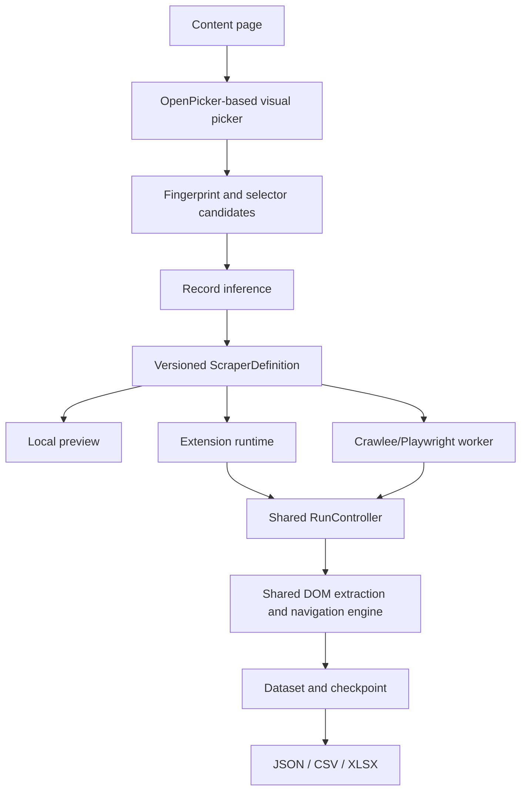

# Architecture

`packages/scraper-schema` defines the portable contract and validates every saved or loaded definition. `packages/scraper-dom` owns bounded DOM fingerprinting, record inference, relative locators, extraction, navigation detection, and selector recovery. `packages/scraper-core` owns the run state machine, limits, deduplication key, progress events, and repository adapter contract. `packages/scraper-export` produces the three formats.

The extension content script owns transient DOM references and the inspector. Background code mediates privileged browser APIs and stores definitions in `browser.storage.local`; records and checkpoints go to extension-owned IndexedDB. The MV3 background may suspend, so it is not the long-running inference engine. A tab binding lets a new content script resume after a full page navigation.

The worker bundles the same browser DOM module as an IIFE injected into Playwright pages. Crawlee supplies Chromium browser lifecycle and retries. SQLite records and checkpoints are committed transactionally. The worker profile is separate from the extension user's browser session.

Run checkpoints contain the definition revision, page and record counts, URL, navigation attempts, no-progress count, state signatures, and pending action marker. Deduplication uses a deterministic hash of configured identity fields or all normalized fields; storage checks an existing key before insertion. Current recovery limitations are listed in the README.
